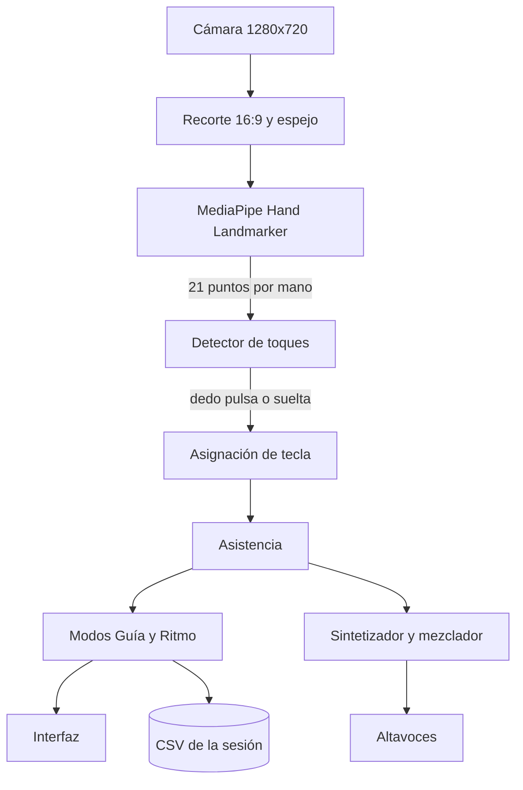

# Piano Aéreo — Jingle Bells con los dedos


| | |
|---|---|
| **Autor** | Daniel Enrique Villamizar Ramírez |
| **Asignatura** | Ciencia de Datos |
| **Semestre** | Sexto semestre |

Aplicación de escritorio, escrita íntegramente en **Python**, que convierte la
cámara del portátil en un piano. Un teclado aparece en pantalla, un modelo de
visión por computador localiza 21 puntos de cada mano en tiempo real y, al
doblar un dedo sobre una tecla, suena su nota. Para interpretar **Jingle Bells**
ofrece un modo guiado nota a nota y un modo de ritmo al estilo de *Guitar Hero*.

Desde la perspectiva de la ciencia de datos, el problema central es **detectar
eventos en una serie de tiempo multivariante y ruidosa**: decidir, fotograma a
fotograma, cuándo un dedo «pulsa» una tecla. El detector se diseñó con
ingeniería de características, se evaluó con datos sintéticos etiquetados y se
corrigió con datos de un usuario real.


| Modo Guía | Resultados del modo Ritmo | Forma «cinco dedos» |
|:---:|:---:|:---:|
|  |  |  |

<sub>Capturas generadas con manos simuladas mediante `scripts/generar_captura.py`. En uso real, el fondo es la imagen de la cámara.</sub>

---

## Contenido

1. [Objetivo y resultados](#1-objetivo-y-resultados)
2. [Características](#2-características)
3. [Tecnologías y modelos](#3-tecnologías-y-modelos)
4. [Instalación y ejecución](#4-instalación-y-ejecución)
5. [Uso](#5-uso)
6. [Arquitectura del sistema](#6-arquitectura-del-sistema)
7. [Fundamentos teóricos](#7-fundamentos-teóricos)
8. [Metodología de ciencia de datos](#8-metodología-de-ciencia-de-datos)
9. [Estructura del proyecto](#9-estructura-del-proyecto)
10. [Pruebas automáticas](#10-pruebas-automáticas)
11. [Robustez y rendimiento](#11-robustez-y-rendimiento)
12. [Antes de una demostración](#12-antes-de-una-demostración)
13. [Solución de problemas](#13-solución-de-problemas)
14. [Limitaciones y trabajo futuro](#14-limitaciones-y-trabajo-futuro)
15. [Referencias, créditos y licencia](#15-referencias-créditos-y-licencia)

---

## 1. Objetivo y resultados

**Objetivo de la actividad:** desarrollar una aplicación para portátil (no para
celular) que permita tocar la canción *Jingle Bells* con los dedos, detectándolos
con la cámara como si se tratara de un piano, usando únicamente Python.

**Resultados principales:**

| Indicador | Valor | Fuente |
|---|---|---|
| F1 del detector de toques | **0,961** (precisión 0,972, sensibilidad 0,949) | Evaluación sintética, 295 toques |
| Notas fantasma | **1,3 por minuto** (13,0 sin rechazo de modo común) | Evaluación sintética |
| Latencia media del toque | 89 ms desde que el dedo empieza a bajar | Evaluación sintética |
| Precisión con un usuario real, forma «apuntar» | **94 %** de las notas del coro correctas | Datos reales reprocesados |
| Precisión con un usuario real, forma «cinco dedos» | 71 % → **82 %** tras las correcciones | Dos sesiones reales |
| Seguimiento de manos | 30 fotogramas por segundo con buena luz | Portátil de pruebas |
| Latencia del audio | 22 ms (WASAPI, 48 kHz) | Portátil de pruebas |
| Pruebas automáticas | 72 superadas | `python -m pytest` |

El análisis completo está en el [informe técnico](docs/INFORME.md).

## 2. Características

**Interpretación**

- **Teclado de piano en pantalla** de diez teclas blancas (Sol3 a Si4): justo
  el rango que necesitan la estrofa y el coro de *Jingle Bells* en Do mayor.
- **Dos formas de tocar**, intercambiables con la tecla `5`:
  - *Apuntar*: cualquier dedo toca la tecla sobre la que está; basta con el índice.
  - *Cinco dedos*: cada dedo recibe una tecla según dónde está la mano, como en
    la técnica de cinco dedos del piano.
- **Detección sin calibración**, con referencia adaptativa por dedo.
- **Dinámica:** cuanto más rápido baja el dedo, más fuerte suena la nota.

**Modos de juego**

| Modo | Descripción |
|---|---|
| **Libre** | Piano sin restricciones. |
| **Guía** | La tecla esperada se ilumina y la canción espera a que se acierte. |
| **Ritmo** | Estilo *Guitar Hero*: notas a tempo, *Perfecto/Bien/Fallo*, combo, multiplicador hasta x4 y calificación de D a S. |
| **Demo** | La canción suena sola con acompañamiento y letra en karaoke. |

**Sonido**

- Síntesis propia con NumPy, sin archivos de audio: piano, campanas y caja de música.
- Acompañamiento generado (bajo, acordes y cascabeles) con cuenta atrás.

**Ciencia de datos**

- Evaluación cuantitativa del detector: precisión, sensibilidad, F1, latencia,
  barridos de parámetros y estudio de ablación.
- CSV de cada interpretación y script de análisis (puntería, aciertos por dedo,
  evolución entre sesiones).
- Calibración automática del retraso de la cámara a partir de los propios toques.
- Espectro de frecuencias en vivo (transformada de Fourier) con la nota dominante.

**Experiencia y fiabilidad**

- Árbol de Navidad que se decora con los aciertos, fuegos artificiales y fanfarria al terminar.
- Gesto de puño para repetir la canción sin tocar el PC.
- Grabación de vídeo y audio de la interpretación.
- Cámara y audio que se reconectan solos; un error inesperado no cierra la ventana.
- Autodiagnóstico antes de presentar y ajustes que se recuerdan entre sesiones.

## 3. Tecnologías y modelos

### 3.1 Modelo de visión: MediaPipe Hand Landmarker

La localización de las manos usa el modelo **Hand Landmarker** de MediaPipe
(Google), incluido en el repositorio en `modelos/hand_landmarker.task`. Es un
paquete de 7,8 MB con pesos en *float16* que se ejecuta en CPU con TensorFlow
Lite (delegado XNNPACK). Contiene dos redes neuronales en cascada:

| Etapa | Red | Entrada → salida |
|---|---|---|
| 1. Detección de palma | Detector de disparo único (*single-shot*) entrenado para palmas, más fáciles de encontrar que la mano completa porque son rígidas y casi cuadradas | Imagen completa → recuadro de cada palma |
| 2. Puntos de la mano | Red de regresión sobre el recorte de cada mano | Recorte → 21 puntos `(x, y, z)`, puntuación de presencia y lateralidad |

En **modo vídeo** (`RunningMode.VIDEO`), el recuadro de cada fotograma se
deriva de los puntos del anterior. El detector de palmas solo vuelve a
ejecutarse cuando se pierde una mano, lo que abarata el seguimiento.

Los 21 puntos siguen una numeración fija:

```
0 muñeca
1-4   pulgar   (CMC, MCP, IP, punta)
5-8   índice   (MCP, PIP, DIP, punta)
9-12  medio
13-16 anular
17-20 meñique  (17 = nudillo del meñique)
```

| Parámetro | Valor |
|---|---|
| Manos máximas | 2 |
| Confianza mínima de detección, presencia y seguimiento | 0,5 |
| Coordenadas usadas | `x`, `y` normalizadas a la imagen (la `z` relativa no se usa por ruidosa) |

No hay entrenamiento propio: el modelo se usa preentrenado. El trabajo de
ciencia de datos del proyecto está en **convertir sus salidas en decisiones**:
qué dedo tocó, cuándo y qué tecla.

### 3.2 Bibliotecas

| Biblioteca | Uso |
|---|---|
| [MediaPipe](https://ai.google.dev/edge/mediapipe/solutions/vision/hand_landmarker) | Inferencia del Hand Landmarker |
| OpenCV (`opencv-contrib-python`) | Captura de cámara, dibujo de la interfaz, vídeo MP4 |
| NumPy | Álgebra de las características, síntesis de audio, FFT |
| sounddevice (PortAudio) | Salida de audio en tiempo real |
| Pillow | Texto con tildes y eñes sobre la imagen |
| matplotlib (solo desarrollo) | Gráficos de la evaluación y del análisis |
| pytest (solo desarrollo) | Pruebas automáticas |

### 3.3 Requisitos

| Requisito | Detalle |
|---|---|
| Python | 3.9 o superior (desarrollado con 3.13) |
| Hardware | Portátil o PC con cámara web y salida de audio |
| Sistema operativo | Windows, macOS o Linux (probado en Windows 11) |

## 4. Instalación y ejecución

### 4.1 Instalación

```bash
git clone https://github.com/Daniverd15/piano-aereo-jingle-bells.git
cd piano-aereo-jingle-bells
```

**Windows, opción rápida.** Hacer doble clic en `ejecutar.bat`. La primera vez
crea un entorno virtual e instala las dependencias; después abre la aplicación.

**Instalación manual (cualquier sistema):**

```bash
python -m venv .venv
.venv\Scripts\activate            # macOS / Linux: source .venv/bin/activate
python -m pip install -r requirements.txt
```

El modelo de manos ya está en `modelos/`. Si faltara, se descarga solo al arrancar.

### 4.2 Ejecución

```bash
python -m piano_aereo                          # abrir el piano
python -m piano_aereo --diagnostico            # comprobar cámara, modelo y audio
python -m piano_aereo --modo ritmo --dificultad facil
python -m piano_aereo --modo demo --cancion completa --timbre campanas
```

El autodiagnóstico produce una salida como esta:

```
[OK] Modelo     hand_landmarker.task (7.8 MB)
[OK] Cámara     cámara 0, 1280x720, seguimiento de manos a 30 fps
[OK] Audio      48000 Hz, latencia 22 ms
Todo listo para tocar.
```

### 4.3 Opciones de línea de órdenes

| Opción | Descripción | Por defecto |
|---|---|---|
| `--modo {libre,guia,ritmo,demo}` | Modo inicial | `guia` |
| `--cancion {coro,completa}` | Coro (51 notas) o canción completa con estrofa (98 notas) | `coro` |
| `--dificultad {facil,normal,dificil}` | Tempo de Ritmo y Demo: 84, 108 o 132 pulsos por minuto | `normal` |
| `--timbre {piano,campanas,cajita}` | Sonido del instrumento | `piano` |
| `--cinco-dedos` | Empezar con la forma «cinco dedos» | apuntar |
| `--camara N` | Índice de la cámara | `0` |
| `--sensibilidad X` | Umbral de toque, de `0.10` (poco) a `0.40` (mucho) | `0.22` |
| `--sin-asistencia` | Desactivar la asistencia de puntería y anti-arrastre | activada |
| `--sin-acompanamiento` | Ritmo y Demo sin bajo, acordes ni cascabeles | con acompañamiento |
| `--sin-camara` | Tocar solo con el teclado del PC | — |
| `--sin-espejo` | No voltear la imagen | espejo |
| `--sin-sonido` | Ejecutar sin audio | — |
| `--pantalla-completa` | Abrir a pantalla completa | — |
| `--ajustes-de-fabrica` | Ignorar los ajustes guardados | — |
| `--registrar-manos` | Guardar los puntos de las manos de cada fotograma (`grabaciones/manos_*.pkl`) | — |
| `--diagnostico` | Comprobar cámara, modelo y audio, y salir | — |
| `--detalle` | Mensajes de diagnóstico en la consola | — |

Los ajustes elegidos en una sesión se guardan en `ajustes.json` y se recuperan
la siguiente vez. Las opciones de la línea de órdenes tienen prioridad.

## 5. Uso

### 5.1 Cómo se toca

Colocar la mano frente a la cámara, a unos 40–60 cm, con la palma hacia ella.
Una nota suena al **doblar un dedo**, como al pulsar una tecla, y se apaga al
estirarlo.

| | Apuntar (por defecto) | Cinco dedos (tecla `5`) |
|---|---|---|
| Qué tecla toca un dedo | La del carril vertical sobre el que está su punta | La asignada según la posición de la mano |
| Puntería | Hay que llevar el dedo al carril | No hace falta |
| Ayuda visual | Línea vertical de cada punta a su tecla | Número del dedo (1 pulgar … 5 meñique) sobre cada tecla y dedo resaltado para la siguiente nota |
| Precisión en la prueba real | 94 % | 82 % |

Con la mano centrada sobre Mi en la forma «cinco dedos», los dedos quedan en
Do–Re–Mi–Fa–Sol y el coro completo se toca sin mover la mano.

### 5.2 Teclas

| Tecla | Acción |
|---|---|
| `1` `2` `3` `4` | Modo Libre, Guía, Ritmo, Demo |
| `5` | Cambiar la forma de tocar: apuntar / cinco dedos |
| `S` | Cambiar canción: coro o completa |
| `D` | Cambiar dificultad (tempo) |
| `T` | Cambiar timbre |
| `P` | Activar o quitar el acompañamiento |
| `A` | Activar o quitar la asistencia |
| `+` / `-` | Más / menos sensibilidad |
| `R` | Reiniciar la canción |
| `L` | Tras el modo Ritmo, corregir el retraso según cómo se ha tocado |
| `O` | Mostrar u ocultar el espectro de frecuencias |
| `G` | Empezar / terminar la grabación de vídeo y audio |
| `I` | Guardar una captura de pantalla |
| `E` | Mostrar u ocultar el esqueleto de la mano |
| `F` | Pantalla completa |
| `H` | Ayuda en pantalla |
| `Z X C V B N M , . /` | Tocar las diez teclas con el teclado del PC |
| Puño 1 s | En los resultados, repetir la canción |
| `Q` / `Esc` | Salir |

### 5.3 Puntuación del modo Ritmo

| Concepto | Regla (dificultad normal) |
|---|---|
| *Perfecto* | Nota a ±0,12 s de su instante exacto: 100 puntos |
| *Bien* | Nota a ±0,24 s: 60 puntos |
| *Fallo* | Nota que se deja pasar: 0 puntos y el combo vuelve a cero |
| Multiplicador | Sube un nivel cada 8 aciertos seguidos, hasta x4 |
| Calificación | S ≥ 95 %, A ≥ 85 %, B ≥ 70 %, C ≥ 50 %, D el resto |

Las tolerancias son ±0,14 / ±0,28 s en fácil y ±0,10 / ±0,20 s en difícil.

## 6. Arquitectura del sistema

### 6.1 Flujo de datos



### 6.2 Hilos de ejecución

El sistema reparte el trabajo en tres hilos, para que ninguno bloquee a los demás:

| Hilo | Responsabilidad | Ritmo |
|---|---|---|
| **Visión** (`vision.py`) | Captura de cámara, recorte, espejo e inferencia de MediaPipe. Publica siempre el fotograma más reciente. | ~30 fotogramas/s |
| **Principal** (`app.py`) | Detector de toques, lógica de juego, dibujo y teclado del PC | Uno por fotograma nuevo |
| **Audio** (PortAudio) | Función de retrollamada que mezcla las voces | Bloques de pocos milisegundos |

Si la inferencia se retrasa, la interfaz no se congela; si el dibujo se
retrasa, el audio no se corta.

### 6.3 Un fotograma, paso a paso

1. El hilo de visión entrega el fotograma con las manos detectadas y su instante de captura.
2. El detector actualiza el estado de los cinco dedos de cada mano y emite los toques.
3. Cada toque se convierte en una tecla (carriles o cinco dedos).
4. La asistencia decide si suena ya, se retiene o se descarta.
5. La tecla suena en el mezclador y se informa al modo de juego.
6. Se dibuja la escena y, si se está grabando, se escribe el fotograma en el vídeo.

## 7. Fundamentos teóricos

### 7.1 Preparación de la imagen

El fotograma se recorta al centro con proporción 16:9 y se voltea en
horizontal (efecto espejo), para que mover la mano a la derecha la mueva a la
derecha en pantalla. Las coordenadas normalizadas de MediaPipe se multiplican
por el tamaño del lienzo (1280 × 720), con lo que los puntos quedan en píxeles
de pantalla.

Las manos se identifican por su **posición** y no por la lateralidad que
estima el modelo, que es poco fiable con la imagen en espejo:

- con dos manos, la de la izquierda en pantalla es `izq` y la otra `der`;
- con una sola, se conserva el nombre de la mano más cercana del fotograma anterior.

Si una mano desaparece menos de 0,25 s, sus notas no se sueltan.

### 7.2 Ingeniería de características

Un toque, visto desde la cámara, es un dedo que **se acorta**, ya sea
doblándose o inclinándose hacia la cámara. Las variables son:

**Tamaño de la palma** — media de los lados del triángulo muñeca (0), nudillo
del índice (5) y nudillo del meñique (17):

```math
P = \frac{\lVert p_0 - p_5 \rVert + \lVert p_0 - p_{17} \rVert + \lVert p_5 - p_{17} \rVert}{3}
```

**Extensión de cada dedo** — distancia de la punta al nudillo, en unidades de palma:

```math
e_i = \frac{\lVert p_{\text{punta},i} - p_{\text{nudillo},i} \rVert}{P}
\qquad
e_{\text{pulgar}} = \frac{\lVert p_4 - p_{17} \rVert}{P}
```

El pulgar no se dobla hacia la palma sino que se cierra sobre ella; por eso se
mide su distancia a la base del meñique.

Al dividir entre $P$, la medida es **invariante a la escala**: no cambia al
acercar o alejar la mano. Además, inclinar la muñeca acorta a la vez los dedos
y la palma, así que el cociente apenas varía.

### 7.3 Detección de toques

Cada dedo es una serie temporal $e_i(t)$. La decisión se toma en línea, con los
datos hasta el fotograma actual, mediante estas etapas:

**1. Suavizado exponencial.** Reduce el temblor de los puntos:

```math
\hat e_i(t) = \hat e_i(t-1) + \alpha \,\big(e_i(t) - \hat e_i(t-1)\big), \qquad \alpha = 0{,}8
```

**2. Referencia de reposo adaptativa y asimétrica.** Estima la longitud del
dedo estirado. Sube rápido y baja despacio:

```math
r_i \leftarrow r_i + k \,(\hat e_i - r_i), \qquad
k = \begin{cases} 0{,}5 & \text{si } \hat e_i \ge r_i \\ 1 - e^{-\Delta t / \tau}, \ \tau = 2{,}5\ \text{s} & \text{si } \hat e_i < r_i \end{cases}
```

Un toque, que es brusco, destaca sobre la referencia. Un cambio lento de
postura se absorbe. Por eso no hace falta calibrar.

**3. Caída relativa:**

```math
c_i = 1 - \frac{\hat e_i}{r_i}
```

**4. Rechazo de modo común.** Al cerrar o relajar la mano, todos los dedos bajan
a la vez. A la caída de cada dedo se le resta la mediana de la caída de los
otros dedos largos:

```math
c_i' = c_i - \max\Big(0,\ \mathrm{mediana}_{\,j \in \{1..4\},\, j \neq i}\ c_j\Big)
```

Si baja un solo dedo, la mediana de los demás es casi cero y $c_i'$ se
conserva; si baja la mano entera, $c_i'$ queda cerca de cero. Es el mecanismo
que más notas fantasma evita (ver la [sección 8.1](#81-evaluación-con-datos-sintéticos-etiquetados)).

**5. Histéresis.** La nota se activa y se suelta con umbrales distintos, para
que no parpadee en el borde:

```math
\text{pulsa si } c_i' \ge \theta = 0{,}22 \qquad\qquad \text{suelta si } c_i < \theta / 2
```

**6. Filtro de dominancia.** Un dedo solo dispara si $c_i \ge 0{,}6 \cdot \max_j c_j$.
Así se ignora el dedo vecino que se arrastra por los tendones.

**7. Reglas de seguridad:**

| Regla | Valor |
|---|---|
| Antirrebote entre dos cambios del mismo dedo | 70 ms |
| Calentamiento al aparecer una mano | 0,3 s |
| Bloqueo mientras la mano se desplaza | rapidez de la muñeca > 3 palmas/s |
| Cambio de postura: 4 o más dedos cruzan a la vez | se toma como nuevo reposo |
| Liberación forzada | tras 5 s pulsado |

**8. Fuerza del toque.** La velocidad de la caída se convierte en volumen:

```math
\text{fuerza} = \mathrm{clip}\!\left(0{,}5 + \frac{\Delta c_i / \Delta t}{8},\ 0{,}5,\ 1\right)
```

Los valores de $\theta = 0{,}22$ y $\alpha = 0{,}8$ **no se eligieron a ojo**:
salen de la evaluación de la [sección 8.1](#81-evaluación-con-datos-sintéticos-etiquetados).

### 7.4 De dedo a tecla

**Forma «apuntar».** El teclado ocupa el ancho de la pantalla y cada tecla
define un carril vertical de ancho $w = 120$ px. La tecla es la del carril donde
estaba la punta del dedo **antes** de doblarse, porque al doblar el dedo la
punta se desplaza (sobre todo la del pulgar). Esa posición se filtra y solo se
actualiza mientras el dedo está quieto.

*Asistencia de puntería:* en Guía y Ritmo, si un toque cae fuera de la tecla
esperada, pero a menos de $0{,}3 \cdot w$ de su borde, cuenta como si hubiera caído en ella.

**Forma «cinco dedos».** Cada mano cubre cinco teclas seguidas, centradas en la
que queda bajo la mediana $\tilde{x}$ de sus puntas:

```math
u = \frac{\tilde{x} - x_0}{w} - \frac12 ,
\qquad
\text{base} = \mathrm{clip}\big(\mathrm{round}(u - 2),\ 0,\ 5\big)
```

- **Histéresis de 0,3 teclas:** la posición no cambia hasta que la mano se aleja
  claramente, para que no parpadee en el borde entre dos teclas.
- **Posición congelada** mientras hay un dedo pulsado.
- **Orden anatómico:** los dedos se ordenan por la anatomía de la mano, no por
  la posición de sus puntas. Si el nudillo del índice ($p_5$) queda a la
  izquierda del del meñique ($p_{17}$), el orden es pulgar → meñique; si no, el
  inverso. Ordenar por las puntas fallaba con datos reales (sección 8.3).

### 7.5 Asistencia anti-arrastre

En Guía y Ritmo la aplicación sabe qué nota se espera, y lo aprovecha:

- Una nota **esperada** suena al instante.
- Una nota **no esperada** se retiene 150 ms:
  - si en ese tiempo llega la esperada, la otra era un dedo arrastrado y se descarta;
  - si no llega, suena como error, solo que 150 ms tarde.
- Una nota no esperada que llega **hasta 150 ms después** de la esperada también se descarta.

Con los datos reales, esta regla subió la precisión de «cinco dedos» del 68 % al
80 % sin perder ninguna nota correcta.

### 7.6 Síntesis de sonido

**Afinación.** Temperamento igual con La4 = 440 Hz, donde $n$ es el número MIDI
de la nota (Do4 = 60):

```math
f(n) = 440 \cdot 2^{(n - 69)/12}\ \text{Hz}
```

**Síntesis aditiva.** Cada nota es una suma de sinusoides amortiguadas:

```math
x(t) = \sum_k a_k \, e^{-\lambda_k t} \sin(2\pi f_k t + \varphi_k)
```

| Timbre | Parciales |
|---|---|
| Piano | 9 armónicos con **inarmonicidad** de cuerda, $f_k = k f_0 \sqrt{1 + B k^2}$ con $B = 0{,}0004$; amplitud $a_k = k^{-1{,}25}$; los agudos se apagan antes: $\lambda_k = 1{,}6 + 0{,}55k + f_0/600$ |
| Campanas | Parciales no armónicos de una campana afinada (razones 0,5 · 1 · 1,183 · 1,506 · 2 · 2,514 · 2,662 · 3,011 · 4,166) |
| Caja de música | Fundamental, octava y un parcial a 4,07 $f_0$ que se apagan rápido |

Cada nota tiene un ataque de 4 ms y una cola de 30 ms para evitar chasquidos,
y se normaliza a un pico de 0,9.

**Mezclador polifónico en tiempo real.** Hay una voz por dedo y la mezcla se
calcula en la retrollamada de `sounddevice`:

- **Paneo de potencia constante:** con $\phi = (p + 1)\pi/4$, la ganancia es
  $\cos\phi$ a la izquierda y $\sin\phi$ a la derecha. Las notas graves suenan
  más a la izquierda y las agudas más a la derecha.
- **Apagado** exponencial al soltar el dedo ($\tau = 90$ ms), como el apagador de un piano.
- **Limitador suave** $y = \tanh(g x)$, para que los acordes no saturen.
- **Baja latencia:** en Windows se prefiere WASAPI, de menor latencia que el
  controlador por defecto (MME); en el portátil de pruebas se midieron 22 ms.

**Acompañamiento.** La partitura incluye un acorde por compás (Do, Fa, Sol, Re).
El acompañamiento se **renderiza de una vez como una sola onda**, de modo que
todo queda sincronizado con precisión de muestra:

- cuatro clics de cuenta atrás;
- bajo alternado (fundamental en los tiempos 1 y quinta en el 3);
- acordes en los tiempos 2 y 4;
- cascabeles en cada pulso y contratiempo;
- en Demo, también la melodía.

### 7.7 La canción

*Jingle Bells* (James Lord Pierpont, 1857, dominio público) está escrita como
texto, una frase por línea:

```python
"E4:1:Jin- E4:1:gle E4:2:bells,"      # nota : pulsos : sílaba
```

Las pruebas verifican que cada frase cuadra en compases de 4/4 y que todas las
notas caben en el teclado. El coro tiene 51 notas (64 pulsos) y la canción
completa 98 notas (128 pulsos).

### 7.8 Modo Ritmo: tiempo y calificación

El instante exacto de la nota $i$ es:

```math
t_i = t_0 + \left(b_i + 4\right) \cdot \frac{60}{\text{bpm}}
```

donde $b_i$ es su pulso en la partitura y los 4 pulsos son la cuenta atrás.

Se compensan dos retrasos para que el juicio sea justo:

- **Audio:** $t_0$ incluye la latencia de salida medida, de modo que la nota
  cruza la línea de golpe justo cuando se oye el pulso.
- **Cámara:** al instante del toque se le resta el retraso de la cámara (50 ms
  por defecto, calibrable).

Cada toque se asocia a la nota más antigua, sin juzgar y de la misma tecla,
dentro de la tolerancia. El desfase $\delta = t_{\text{toque}} - t_i$ decide
*Perfecto* o *Bien*.

- **Puntos:** base × multiplicador, con multiplicador $= \min(4,\ 1 + \lfloor \text{combo}/8 \rfloor)$.
- **Precisión:** puntos base obtenidos dividido entre $100 \cdot N$.

### 7.9 Calibración del retraso

Al terminar una canción en Ritmo, la corrección propuesta es la **mediana** de
los desfases de las notas acertadas:

```math
\Delta = \mathrm{mediana}(\delta_1, \dots, \delta_m), \qquad \text{si } m \ge 10 \text{ y } |\Delta| \ge 25\ \text{ms}
```

Con la tecla `L`, el retraso compensado pasa a ser $r \leftarrow r + \Delta$ y se
guarda. Se usa la mediana y no la media por **robustez**: un toque muy
desviado no arrastra la estimación.

### 7.10 Espectro de frecuencias (Fourier)

Con la tecla `O` se analizan las últimas $N = 4096$ muestras que salieron por
los altavoces (85 ms a 48 kHz):

1. **Ventana de Hann**, $w[n] = 0{,}5 \left(1 - \cos\frac{2\pi n}{N-1}\right)$, para reducir la fuga espectral.
2. **FFT real.** La amplitud de cada sinusoide se recupera como
   $2|X_k| / (0{,}5 \cdot N)$, porque la ventana reduce la ganancia a la mitad.
3. **56 bandas en escala logarítmica** entre 90 y 2200 Hz, como las teclas de
   un piano: cada octava ocupa el mismo ancho. Se muestran en un rango de 60 dB.
4. **Nota dominante.** El pico se refina con interpolación parabólica sobre el
   logaritmo de la amplitud, lo que da más precisión que la resolución de un
   bin ($f_s/N \approx 11{,}7$ Hz):

```math
\hat k = k + \frac{1}{2}\,\frac{a - c}{a - 2b + c}
```

donde $a$, $b$ y $c$ son el logaritmo de la amplitud en los bins $k-1$, $k$ y
$k+1$. La frecuencia se convierte en nota con $n = 69 + 12\log_2(f/440)$.

## 8. Metodología de ciencia de datos

### 8.1 Evaluación con datos sintéticos etiquetados

No existe un conjunto de datos público de «toques de piano en el aire», así que
el proyecto incluye un generador de sesiones etiquetadas
(`scripts/evaluar_detector.py`). Funciona con una mano paramétrica de 21 puntos
(`piano_aereo/simulacion.py`).

Cada sesión dura 60 s a 30 fps y mezcla toques reales con todo lo que *no*
debería sonar:

| Fenómeno | Simulación |
|---|---|
| Toques reales | Cada 0,55–1,3 s; bajada de 70–150 ms; flexión del 55–100 % |
| Arrastre del dedo vecino | 10–40 % de la flexión del toque |
| Desplazamiento entre teclas | 0,25–0,45 s sin tocar |
| Cambio lento de postura | 25–45 % de flexión en 2–3 s |
| Inclinación de muñeca y cierre de mano | Los cuatro dedos juntos, 45–75 % |
| Distancia a la cámara | Tamaño de la mano entre 95 y 145 px |
| Temblor de los puntos | Ruido gaussiano del 0,8 % del tamaño de la mano (barrido de 0 a 2,5 %) |

Como se conoce el instante de cada toque real, una detección es un **acierto**
si suena el dedo correcto en los 350 ms siguientes; cualquier otra nota es un
**falso positivo**. Con 6 sesiones (295 toques) y semilla fija se miden:

```math
\text{precisión} = \frac{VP}{VP + FP} \qquad
\text{sensibilidad} = \frac{VP}{VP + FN} \qquad
F_1 = \frac{2 \cdot \text{precisión} \cdot \text{sensibilidad}}{\text{precisión} + \text{sensibilidad}}
```

además de la latencia media y los falsos positivos por minuto.

```bash
python -m pip install -r requirements-dev.txt
python scripts/evaluar_detector.py
```


**Elección del umbral.** Se buscó un equilibrio entre notas fantasma (umbral
bajo) y notas perdidas y latencia (umbral alto):

| Umbral | Precisión | Sensibilidad | F1 | Latencia | Falsos/min |
|---|---:|---:|---:|---:|---:|
| 0,20 | 0,943 | 0,953 | 0,948 | 84 ms | 2,8 |
| **0,22** | **0,972** | **0,949** | **0,961** | **89 ms** | **1,3** |
| 0,24 | 0,989 | 0,946 | 0,967 | 93 ms | 0,5 |

El F1 máximo está en 0,24, pero se eligió 0,22 por robustez ante un supuesto
del simulador. Con toques más suaves (flexión del 35–70 %), 0,24 solo detecta
el 67 % de los toques y 0,22 el 73 %; bajar el umbral a 0,18 con la tecla `+`
lo sube al 90 %.

**Robustez ante el ruido.** El F1 pasa de 0,971 sin ruido a 0,949 con un ruido
tres veces mayor que el supuesto.

**Ablación.** Se retira cada mecanismo por separado y se mide su efecto:

| Mecanismo retirado | F1 | Falsos/min |
|---|---:|---:|
| Ninguno (detector completo) | 0,961 | 1,3 |
| Rechazo de modo común | 0,866 | 13,0 |
| Referencia adaptativa | 0,914 | 4,5 |
| Filtro de dominancia | 0,956 | 1,8 |
| Bloqueo al desplazar la mano | 0,959 | 1,5 |

El rechazo de modo común se añadió **porque la evaluación lo pidió**: sin él, al
cerrar la mano los dedos cruzaban el umbral en fotogramas distintos y sonaban
notas fantasma. Las tablas completas están en
[RESULTADOS_EVALUACION.md](docs/RESULTADOS_EVALUACION.md).

> Los datos son sintéticos: sirven para comparar variantes y elegir parámetros
> con criterio, no garantizan las mismas cifras con cualquier mano real. Por
> eso se completó con datos reales (8.3).

### 8.2 Datos de cada interpretación

Al terminar una canción en Guía o Ritmo se guarda en `grabaciones/` un CSV con
una fila por nota tocada:

| Columna | Contenido |
|---|---|
| `segundo` | Momento desde que empezó la canción |
| `modo`, `forma` | Modo de juego y forma de tocar |
| `mano`, `dedo` | Qué mano y qué dedo tocó |
| `nota_tocada`, `nota_esperada` | Qué sonó y qué pedía la canción |
| `resultado` | `acierto` / `error` (Guía); `perfecto` / `bien` / `sobra` (Ritmo) |
| `desfase_ms` | En Ritmo, adelanto (−) o atraso (+) de la nota |
| `fuerza` | Intensidad del toque, de 0,5 a 1 |

El script de análisis reúne todas las sesiones y responde tres preguntas: si se
toca tarde o temprano, qué dedos fallan más y si hay mejora de una sesión a otra.

```bash
python scripts/analizar_sesion.py
```


<sub>Ejemplo generado con tres sesiones simuladas.</sub>

### 8.3 Prueba con un usuario real

El autor tocó el coro completo en el modo Guía con las dos formas, con la
opción `--registrar-manos`. Se grabaron **9,5 minutos (13 596 fotogramas)** de
puntos de las manos.

**Hallazgos en los datos:**

- **Desorden de los dedos.** El orden de los dedos por la posición de sus puntas
  no coincidía con el anatómico en el **18 %** de los fotogramas. En la mano
  izquierda, la asignación de «cinco dedos» cambiaba en el **54 %** de ellos,
  porque las puntas del anular y el meñique se cruzaban. Se pasó al orden anatómico.
- **Errores de «cinco dedos».** De los 21 errores, 10 fueron de dedo o posición
  equivocados, 7 de un dedo arrastrado que sonaba **a la vez o justo después**
  del correcto, y 4 de la otra mano moviéndose.

**Banco de pruebas con datos reales.** Los fotogramas grabados se reproducen a
través del detector. Primero se validó que la reproducción es exacta (mismos
aciertos y errores que en vivo). Después se evaluaron variantes contra la
**intención** del usuario: en cada instante, la nota que pedía la canción en vivo.

| Variante | Apuntar | Cinco dedos |
|---|---|---|
| Original | 51 correctas / 4 sobrantes | 49 / 23 (68 %) |
| Un dedo por mano a la vez | 51 / 3 | 45 / 20 (pierde correctas) |
| **Asistencia anti-arrastre (adoptada)** | **51 / 3 (94 %)** | **49 / 12 (80 %)** |

Una variante que exigía más caída al pulgar se descartó: en la forma «apuntar»
el usuario lo usaba de verdad, y los aciertos caían de 51 a 18.

**Segunda sesión, con las correcciones aplicadas.** El coro en «cinco dedos»
dio 51 correctas y 11 errores (**82 %**, frente al 71 % de la primera). En Ritmo
(fácil) se acertaron 36 de 51 notas. La mediana del desfase fue de +72 ms
(tarde), justo el caso que corrige la calibración con `L`.

## 9. Estructura del proyecto

```
piano-aereo-jingle-bells/
├── piano_aereo/
│   ├── app.py            Bucle principal, modos, teclas, asistencia
│   ├── vision.py         Cámara y MediaPipe en un hilo propio, con reconexión
│   ├── toques.py         Detector de toques (características, filtros, decisión)
│   ├── asignacion.py     Forma «cinco dedos»: una tecla por dedo
│   ├── notas.py          Notas, frecuencias y geometría del teclado
│   ├── canciones.py      Partitura de Jingle Bells; modos Guía, Ritmo y Demo
│   ├── sintetizador.py   Síntesis aditiva, acompañamiento y mezclador
│   ├── espectro.py       Análisis de Fourier
│   ├── sesion.py         CSV de cada interpretación y calibración
│   ├── interfaz.py       Dibujo de la escena
│   ├── adornos.py        Árbol de Navidad y fuegos artificiales
│   ├── gestos.py         Gesto de puño
│   ├── grabacion.py      Vídeo, audio y capturas
│   ├── ajustes.py        Ajustes recordados entre sesiones
│   ├── texto.py          Texto con tildes sobre OpenCV
│   ├── simulacion.py     Mano sintética para pruebas y evaluación
│   └── config.py         Constantes ajustables
├── modelos/              Modelo Hand Landmarker de MediaPipe
├── scripts/
│   ├── evaluar_detector.py   Evaluación cuantitativa del detector
│   ├── analizar_sesion.py    Análisis de los CSV de interpretaciones
│   └── generar_captura.py    Capturas de la documentación
├── tests/                72 pruebas automáticas (pytest)
├── docs/
│   ├── INFORME.md                  Informe técnico
│   ├── RESULTADOS_EVALUACION.md    Tablas completas de la evaluación
│   └── *.png                       Gráficos y capturas
├── CHANGELOG.md          Registro de cambios
├── ejecutar.bat          Instalación y arranque en Windows
├── main.py               Atajo: python main.py
├── requirements.txt      Dependencias de la aplicación
└── requirements-dev.txt  Dependencias de pruebas y evaluación
```

## 10. Pruebas automáticas

```bash
python -m pip install -r requirements-dev.txt
python -m pytest
```

Las 72 pruebas no necesitan cámara ni altavoces: una mano sintética dobla los
dedos y se comprueba todo el recorrido. Escriben solo en carpetas temporales.

| Área | Qué verifican |
|---|---|
| Detector | Cada dedo pulsa y suelta; un cambio lento de postura, cerrar la mano o un dedo arrastrado **no** suenan; la medida es invariante a la distancia |
| Calidad | Una sesión sintética mantiene F1 ≥ 0,94 (prueba de regresión) |
| Música | Frecuencias, compases, acordes, síntesis sin chasquidos y frecuencia dominante correcta |
| Juego | Calificación por desfase, combo y multiplicador; el coro completo se toca sin errores en Guía, Ritmo y «cinco dedos» |
| Casos reales | Dedos cruzados en «cinco dedos» y arrastres antes y después de la nota correcta |
| Datos | CSV, análisis, calibración por mediana, espectro de La4, Do4 y Sol3 |
| Robustez | Cámara que no abre o se desconecta, audio que se pierde, errores al dibujar, grabación sincronizada |

## 11. Robustez y rendimiento

| Situación | Comportamiento |
|---|---|
| La cámara no abre, se desconecta o deja de enviar imagen | Se reintenta cada 2 s (DirectShow y Media Foundation); mientras, se puede tocar con el teclado del PC |
| La cámara entrega imagen negra (tapa cerrada u ocupada) | Aviso en pantalla y en el diagnóstico |
| Se pierde la salida de audio | Se reabre sola en unos segundos |
| Error inesperado al dibujar, procesar o atender una tecla | Se salta el fotograma y queda en `piano_aereo.log`; la ventana no se cierra |
| Error dentro del mezclador | Ese bloque sale en silencio; el sonido continúa |

**Rendimiento medido** (portátil de pruebas, Windows 11): cámara lista en unos
2 s, bucle a 32 fotogramas/s, unos 9 ms de dibujo por fotograma y 22 ms de
latencia de audio. Vídeo y audio grabados quedan sincronizados (23 ms de diferencia).

## 12. Antes de una demostración

1. Ejecutar `python -m piano_aereo --diagnostico`: todo debe salir en `[OK]`.
2. Cerrar las aplicaciones que usen la cámara y abrir su tapa de privacidad.
3. Buscar luz de frente, no a contraluz, y subir el volumen.
4. Abrir la aplicación, pulsar `F` y calentar en Guía (`2`) antes de Ritmo (`3`).
5. Tras una canción en Ritmo, pulsar `L` si la aplicación sugiere corregir el retraso.
6. Para dejar evidencia, `G` empieza y termina la grabación (vídeo `.mp4` y
   audio `.wav` en `grabaciones/`).

## 13. Solución de problemas

| Síntoma | Qué hacer |
|---|---|
| Suenan notas sin querer | Pulsar `-` para subir el umbral |
| Cuesta que suenen las notas | Pulsar `+`; doblar el dedo con un movimiento rápido y marcado |
| No detecta las manos | Mejorar la luz frontal y acercar la mano a 40–60 cm |
| «La cámara da imagen negra» | Abrir la tapa de privacidad o cerrar la aplicación que la usa |
| Se abre otra cámara | Usar `--camara 1` (o `2`) |
| Los toques caen en la tecla de al lado | Mantener la asistencia (`A`) o usar la forma «cinco dedos» (`5`) |
| En «cinco dedos» cuesta mover anular o meñique | Volver a «apuntar» con `5` y tocar con el índice |
| En Ritmo siempre sale «tarde» o «temprano» | Terminar una canción y pulsar `L` |
| En Ritmo las notas van muy rápido | Pulsar `D` hasta la dificultad Fácil |
| La aplicación arranca con una configuración extraña | Arrancar con `--ajustes-de-fabrica` o borrar `ajustes.json` |
| El vídeo grabado no tiene sonido | El audio está en el `.wav` del mismo nombre; se unen en cualquier editor de vídeo |
| Algo raro pasó durante el uso | Revisar `piano_aereo.log` |

## 14. Limitaciones y trabajo futuro

- La evaluación principal usa datos sintéticos; la prueba real cubre a un solo
  usuario. El siguiente paso es reunir sesiones etiquetadas de varias personas.
- El retraso de la cámara parte de un supuesto (50 ms) que la calibración
  ajusta. La calibración mezcla el retraso del equipo con el hábito de quien
  toca; separarlos exigiría una medida independiente, como una cámara de alta velocidad.
- Como mucho dos dedos a la vez por mano: los acordes de tres o más dedos se
  confunden con cerrar la mano.
- La detección empeora con poca luz o a contraluz, y funciona mejor con la palma hacia la cámara.
- Solo hay teclas blancas (Do mayor), suficiente para *Jingle Bells*.

## 15. Referencias, créditos y licencia

- Zhang, F., Bazarevsky, V., Vakunov, A., *et al.* (2020). *MediaPipe Hands:
  On-device Real-time Hand Tracking*. arXiv:2006.10214.
- Google. *MediaPipe Hand Landmarker* — [documentación](https://ai.google.dev/edge/mediapipe/solutions/vision/hand_landmarker).
  Modelo distribuido bajo licencia Apache 2.0.
- Fletcher, N. H., y Rossing, T. D. (1998). *The Physics of Musical
  Instruments* (2.ª ed.). Springer. Inarmonicidad de las cuerdas y parciales de
  las campanas.
- Harris, F. J. (1978). On the use of windows for harmonic analysis with the
  discrete Fourier transform. *Proceedings of the IEEE*, 66(1), 51–83.
- *Jingle Bells*: James Lord Pierpont, 1857 (dominio público).

© 2026 Daniel Enrique Villamizar Ramírez. Código publicado bajo la [licencia MIT](LICENSE).
