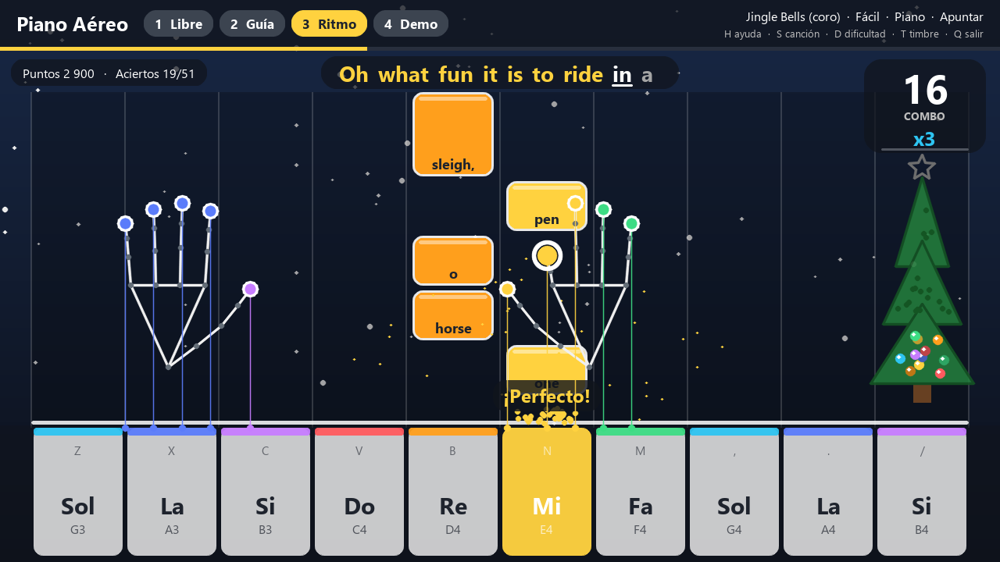
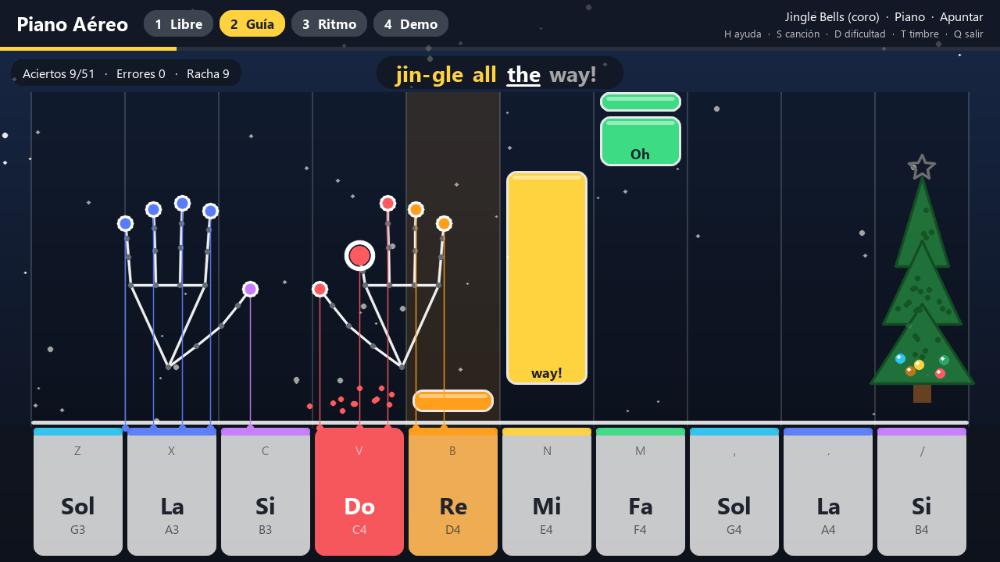
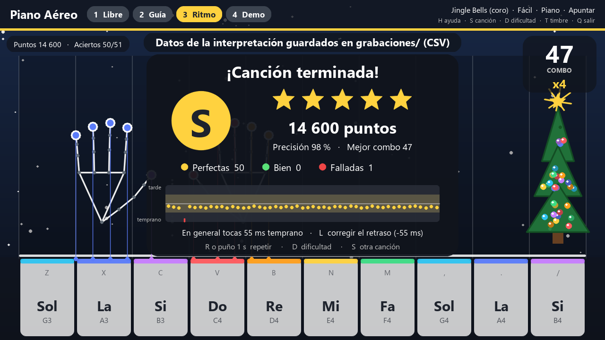
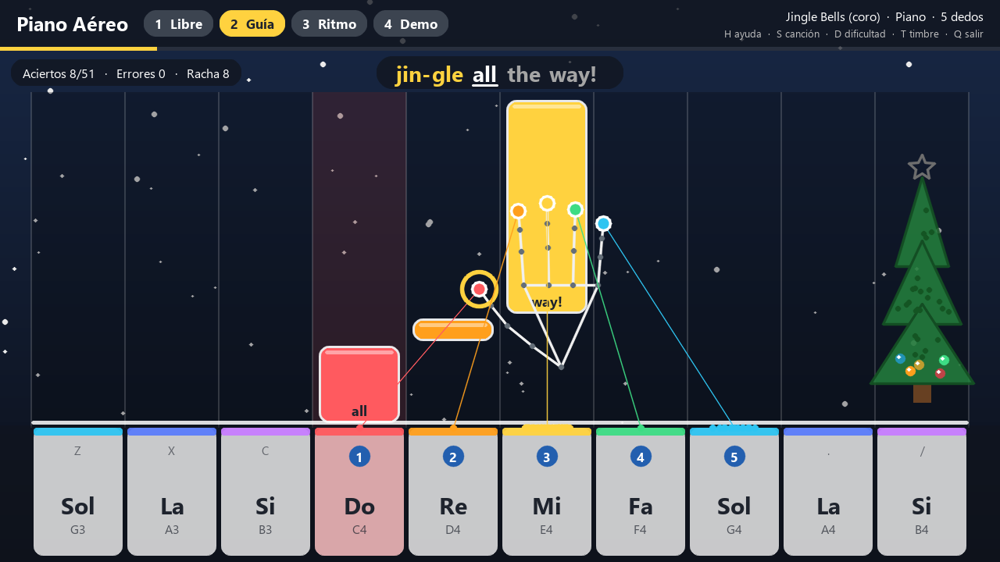
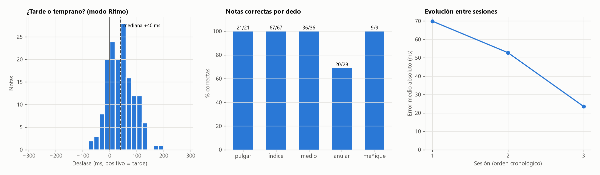

# Piano Aéreo — Jingle Bells con los dedos


Aplicación de escritorio, escrita íntegramente en **Python**, que convierte la
cámara del portátil en un piano. Un teclado aparece en pantalla, la cámara
sigue las manos en tiempo real y, al doblar un dedo sobre una tecla, suena su
nota. Para interpretar **Jingle Bells** ofrece un modo guiado, nota a nota, y un
modo de ritmo al estilo de *Guitar Hero*, con notas que caen, combos y puntuación.

**Autor:** Daniel Enrique Villamizar Ramírez
**Asignatura:** Ciencia de Datos



| Modo Guía | Resultados del modo Ritmo |
|:---:|:---:|
|  |  |

<sub>Capturas generadas con manos simuladas mediante `scripts/generar_captura.py`. En uso real, el fondo es la imagen de la cámara.</sub>

---

## Contenido

1. [Objetivo](#objetivo)
2. [Características](#características)
3. [Requisitos](#requisitos)
4. [Instalación y ejecución](#instalación-y-ejecución)
5. [Cómo se toca](#cómo-se-toca)
6. [Modos y controles](#modos-y-controles)
7. [Cómo funciona](#cómo-funciona)
8. [Evaluación del detector](#evaluación-del-detector)
9. [Datos de tus interpretaciones](#datos-de-tus-interpretaciones)
10. [Estructura del proyecto](#estructura-del-proyecto)
11. [Pruebas](#pruebas)
12. [Antes de una demostración](#antes-de-una-demostración)
13. [Solución de problemas](#solución-de-problemas)
14. [Limitaciones](#limitaciones)
15. [Créditos y licencia](#créditos-y-licencia)

---

## Objetivo

Desarrollar una aplicación para portátil que permita tocar la canción *Jingle
Bells* con los dedos, detectándolos con la cámara como si se tratara de un
piano, usando únicamente Python.

## Características

- **Teclado de piano en pantalla.** Diez teclas blancas (Sol3 a Si4). Cualquier
  dedo de cualquiera de las dos manos puede tocar cualquier tecla, mantener
  notas y formar acordes de dos dedos por mano.
- **Dos formas de tocar**, intercambiables con la tecla `5`: *apuntar* el dedo
  a la tecla, o *cinco dedos*, donde cada dedo recibe una tecla según dónde está
  la mano y se ve su número de digitación sobre el teclado.
- **Detección de toques sin calibración.** El sistema aprende solo cómo es cada
  dedo estirado y se adapta a la distancia y a la postura de la mano.
- **Detector evaluado con datos.** Sesiones sintéticas etiquetadas miden
  precisión, sensibilidad, F1 y latencia; el umbral y el suavizado se eligieron
  con esas medidas. F1 = 0,96 con 1,3 notas fantasma por minuto
  ([informe técnico](docs/INFORME.md)).
- **Cuatro modos de uso:** Libre, Guía (la canción espera a que se acierte cada
  nota), Ritmo (estilo *Guitar Hero*) y Demo (la canción suena sola).
- **Modo Ritmo.** Las notas caen a tempo hacia el teclado y hay que tocarlas al
  cruzar la línea de golpe. Cada nota se califica como *Perfecto*, *Bien* o
  *Fallo*; los aciertos seguidos forman un combo que multiplica los puntos hasta
  x4, y al final se obtiene una calificación de D a S. Tres dificultades.
- **Acompañamiento musical** generado por la propia aplicación: bajo, acordes y
  cascabeles, con cuenta atrás de entrada.
- **Asistencia de puntería.** Un toque que cae justo al borde de la tecla
  esperada se da por bueno, lo que hace la interpretación más tolerante.
- **Jingle Bells en dos versiones:** el coro (51 notas) o la canción completa
  con estrofa (98 notas), con la letra en pantalla estilo karaoke.
- **Sonido sintetizado.** No se usan archivos de audio: cada nota se genera
  matemáticamente con NumPy. Tres timbres: piano, campanas y caja de música.
- **Respuesta en tiempo real.** Seguimiento de manos a 30 fotogramas por
  segundo y salida de audio de baja latencia.
- **Ayudas visuales.** Cada punta de dedo muestra una línea hacia la tecla que
  tocaría y un arco que indica cuánto falta para que suene.
- **Datos de cada interpretación.** Al terminar una canción se guarda un CSV
  con cada nota tocada (dedo, tecla, acierto y, en Ritmo, cuántos ms se adelantó
  o atrasó), y `scripts/analizar_sesion.py` los analiza con gráficos.
- **Calibración automática del retraso.** Tras el modo Ritmo, la aplicación mide
  si en general se toca tarde o temprano y, con `L`, corrige el retraso de la
  cámara para que la puntuación sea justa en ese equipo.
- **Espectro de frecuencias en vivo** (`O`): análisis de Fourier del sonido que
  sale por los altavoces, con la nota dominante y su frecuencia en Hz.
- **Árbol de Navidad** que se adorna con cada acierto y se corona con una
  estrella, fuegos artificiales y una fanfarria de campanas al terminar.
- **Gesto de puño.** En la pantalla de resultados, cerrar la mano un segundo
  repite la canción sin tocar el teclado del PC.
- **Ajustes recordados.** Forma de tocar, sensibilidad, timbre, dificultad y
  corrección de retraso se guardan en `ajustes.json` para la próxima vez.
- **Grabación de la interpretación.** Con `G` se graba vídeo (`.mp4`) y audio
  (`.wav`) para entregarlo como evidencia; con `I`, una captura de pantalla.
- **Pensada para no fallar en directo.** La cámara y el audio se reconectan
  solos si se pierden, un error inesperado se salta un fotograma en lugar de
  cerrar la ventana y todo queda anotado en `piano_aereo.log`.
- **Autodiagnóstico** (`--diagnostico`) que comprueba cámara, modelo y audio
  antes de una presentación.
- **Pruebas automáticas** que verifican el recorrido completo sin necesidad de
  cámara ni altavoces.

## Requisitos

| Requisito | Detalle |
|-----------|---------|
| Python | 3.9 o superior |
| Hardware | Portátil o PC con cámara web y salida de audio |
| Sistema operativo | Windows, macOS o Linux (desarrollado y probado en Windows 11) |

Dependencias (se instalan desde `requirements.txt`):

| Biblioteca | Uso en el proyecto |
|------------|--------------------|
| [MediaPipe](https://ai.google.dev/edge/mediapipe/solutions/vision/hand_landmarker) | Localiza 21 puntos de cada mano en la imagen |
| OpenCV | Captura de la cámara y dibujo de la interfaz (se instala junto con MediaPipe) |
| NumPy | Cálculos geométricos y síntesis de sonido |
| sounddevice | Salida de audio en tiempo real |
| Pillow | Texto con tildes y eñes en la interfaz |

## Instalación y ejecución

```bash
git clone https://github.com/Daniverd15/piano-aereo-jingle-bells.git
cd piano-aereo-jingle-bells
```

**Windows (opción rápida).** Hacer doble clic en `ejecutar.bat`. La primera vez
crea el entorno virtual e instala las dependencias; después abre la aplicación.

**Instalación manual (cualquier sistema).**

```bash
python -m venv .venv
.venv\Scripts\activate            # macOS / Linux: source .venv/bin/activate
python -m pip install -r requirements.txt
python -m piano_aereo
```

El modelo de detección de manos está incluido en `modelos/`. Si faltara, la
aplicación lo descarga automáticamente al arrancar.

### Opciones de línea de comandos

| Opción | Descripción | Valor por defecto |
|--------|-------------|-------------------|
| `--modo {libre,guia,ritmo,demo}` | Modo inicial | `guia` |
| `--cancion {coro,completa}` | Versión de Jingle Bells | `coro` |
| `--dificultad {facil,normal,dificil}` | Velocidad de los modos Ritmo y Demo (84, 108 o 132 pulsos por minuto) | `normal` |
| `--timbre {piano,campanas,cajita}` | Sonido del instrumento | `piano` |
| `--camara N` | Índice de la cámara | `0` |
| `--sensibilidad X` | Cuánto hay que doblar el dedo, de `0.10` (poco) a `0.40` (mucho) | `0.22` |
| `--cinco-dedos` | Empezar con la forma de tocar «cinco dedos» | desactivado |
| `--sin-asistencia` | No perdonar los toques al borde de la tecla esperada | desactivado |
| `--sin-acompanamiento` | Modos Ritmo y Demo sin bajo, acordes ni cascabeles | desactivado |
| `--sin-camara` | Tocar solo con el teclado del PC | desactivado |
| `--sin-espejo` | No voltear la imagen como un espejo | desactivado |
| `--sin-sonido` | Ejecutar sin audio | desactivado |
| `--pantalla-completa` | Abrir a pantalla completa | desactivado |
| `--ajustes-de-fabrica` | Ignorar los ajustes guardados de la última vez | desactivado |
| `--diagnostico` | Comprobar cámara, modelo y audio, y salir | — |
| `--detalle` | Mostrar mensajes de diagnóstico en la consola | desactivado |

Ejemplo:

```bash
python -m piano_aereo --modo ritmo --dificultad facil
python -m piano_aereo --modo demo --cancion completa --timbre campanas
```

## Cómo se toca

Colocar la mano frente a la cámara, a unos 40–60 cm, con la palma hacia ella y
los dedos estirados. Una nota suena al **doblar un dedo**, como al pulsar una
tecla, y se apaga al estirarlo. La aplicación ofrece dos formas de decidir qué
tecla toca cada dedo; se cambia entre ellas con la tecla `5`.

### Apuntar con el dedo (forma por defecto)

Cada tecla tiene un *carril* vertical en la pantalla. De cada punta de dedo baja
una línea hasta la tecla de su carril: se mueve la mano para llevar el dedo
sobre la tecla y se dobla. Cualquier dedo puede tocar cualquier tecla, como en
un piano, y basta con usar el índice, el dedo más fácil de mover por separado.

### Cinco dedos (tecla `5` o `--cinco-dedos`)

Como en la técnica del piano, la mano se coloca sobre cinco teclas seguidas y
**cada dedo recibe una automáticamente**, sin apuntar. La tecla central es la
que queda bajo el centro de la mano, y cada tecla muestra el número del dedo
que la toca (1 pulgar, 2 índice, 3 medio, 4 anular, 5 meñique). En los modos
Guía y Ritmo, un círculo dorado señala el dedo que debe tocar la siguiente nota.



Con la mano centrada sobre Mi, los dedos quedan en Do–Re–Mi–Fa–Sol y **el coro
completo de Jingle Bells se toca sin mover la mano**. Para la estrofa, que baja
hasta Sol grave, basta con desplazarla: las cinco teclas se mueven con ella.
Mientras un dedo está pulsado, la posición se queda fija.

| | Apuntar con el dedo | Cinco dedos |
|---|---|---|
| Puntería | Hay que llevar el dedo al carril | No hace falta |
| Dedos que se usan | Puede ser solo el índice | Los cinco, incluidos anular y meñique |
| Mover la mano | Para cada tecla lejana | Solo para cambiar de posición |
| Parecido | Piano | Piano con digitación de cinco dedos |

## Modos y controles

| Tecla | Modo | Descripción |
|:-----:|------|-------------|
| `1` | **Libre** | Piano sin restricciones. |
| `2` | **Guía** | La tecla que corresponde se ilumina y la canción espera hasta que se toca la nota correcta. Registra aciertos, errores y racha, y al terminar muestra la precisión, el tiempo y de una a tres estrellas. Es el modo recomendado para aprender la canción. |
| `3` | **Ritmo** | Como en *Guitar Hero*: tras una cuenta atrás, las notas caen a tempo con acompañamiento y hay que tocarlas cuando cruzan la línea de golpe. Puntúa con combo y multiplicador, y termina con una calificación de D a S. |
| `4` | **Demo** | La canción suena sola, con acompañamiento. Sirve para escucharla; se puede tocar encima. |

### Puntuación del modo Ritmo

| Concepto | Regla |
|----------|-------|
| *Perfecto* | Nota tocada a ±0,12 s de su instante exacto (dificultad normal): 100 puntos |
| *Bien* | Nota tocada a ±0,24 s: 60 puntos |
| *Fallo* | Nota que se deja pasar: 0 puntos y el combo vuelve a cero |
| Multiplicador | Sube un nivel cada 8 aciertos seguidos, hasta x4 |
| Calificación | Según la precisión: S ≥ 95 %, A ≥ 85 %, B ≥ 70 %, C ≥ 50 %, D el resto |

Tocar una tecla que no corresponde suena, pero no resta puntos. Las tolerancias
son más amplias en dificultad fácil (±0,14 s y ±0,28 s) y más estrechas en
difícil (±0,10 s y ±0,20 s).

### Teclas

| Tecla | Acción |
|-------|--------|
| `S` | Cambiar entre el coro y la canción completa |
| `D` | Cambiar la dificultad (velocidad) de los modos Ritmo y Demo |
| `T` | Cambiar el timbre |
| `P` | Activar o quitar la pista de acompañamiento |
| `5` | Cambiar la forma de tocar: apuntar con el dedo / cinco dedos |
| `A` | Activar o quitar la asistencia de puntería (forma «apuntar») |
| `+` / `-` | Aumentar / reducir la sensibilidad |
| `R` | Reiniciar la canción |
| `E` | Mostrar u ocultar el esqueleto de la mano |
| `F` | Pantalla completa |
| `G` | Empezar / terminar la grabación de vídeo y audio |
| `I` | Guardar una captura de pantalla |
| `O` | Mostrar u ocultar el espectro de frecuencias |
| `L` | Tras el modo Ritmo, corregir el retraso según cómo has tocado |
| Puño 1 s | En la pantalla de resultados, repetir la canción |
| `H` | Ayuda en pantalla |
| `Z X C V B N M , . /` | Tocar las diez teclas con el teclado del PC |
| `Q` / `Esc` | Salir |

## Cómo funciona

```
 Cámara ──▶ MediaPipe ──▶ Detector de toques ──▶ Teclado ──▶ Sintetizador ──▶ Altavoces
 (hilo      21 puntos     ¿se acortó            tecla según    ondas generadas
  propio)   por mano      algún dedo?           la posición    con NumPy
                                                de la punta
```

### 1. Visión por computador — `vision.py`

Un hilo independiente captura la cámara, voltea la imagen como un espejo y
procesa cada fotograma con el modelo *Hand Landmarker* de MediaPipe, que
devuelve 21 puntos por mano (muñeca, nudillos, articulaciones y puntas). Al
ejecutarse separado del dibujo, la interfaz nunca se bloquea y siempre se
trabaja con el fotograma más reciente.

### 2. Detección de toques — `toques.py`

Es el núcleo del proyecto. La idea es que pulsar una tecla equivale a
**acortar un dedo** visto desde la cámara. Para cada dedo se calcula:

```
extensión = distancia(punta, nudillo) / tamaño de la palma
```

Al dividir por el tamaño de la palma, la medida es la misma con la mano cerca o
lejos de la cámara. Sobre esa señal se aplican varias reglas:

| Mecanismo | Problema que resuelve |
|-----------|-----------------------|
| **Referencia adaptativa** | Cada dedo guarda su extensión "en reposo", que sube rápido y baja despacio. Un toque (brusco) destaca; un cambio lento de postura se absorbe. No hace falta calibrar. |
| **Rechazo de modo común** | A la caída de cada dedo se le resta la mediana de la de los demás. Si la mano entera se cierra o se relaja, todos bajan a la vez y no suena nada; si baja un solo dedo, sí. Es el mecanismo que más notas fantasma evita. |
| **Histéresis** | La nota se activa cuando el dedo se acorta un 22 % y solo se suelta al recuperar la mitad, lo que evita parpadeos en el umbral. |
| **Filtro de dominancia** | Al doblar un dedo, los vecinos se mueven un poco. Un dedo solo suena si su caída es comparable a la del que más ha bajado. |
| **Detección de cambio de postura** | Si cuatro o más dedos se acortan a la vez, se toma como la nueva postura de reposo. |
| **Antirrebote y calentamiento** | Tiempo mínimo entre dos cambios del mismo dedo, y una mano recién aparecida no puede tocar hasta estabilizarse. |
| **Dinámica** | La velocidad con que baja el dedo determina el volumen de la nota. |
| **Elección de tecla** | Se usa la posición de la punta *antes* de doblarse, porque al doblar el dedo la punta se desplaza. |

Las manos se identifican por su posición en pantalla y no por la lateralidad
que estima el modelo, que es poco fiable con la imagen en espejo.

### 3. Síntesis de sonido — `sintetizador.py`

Cada nota se calcula a partir de su frecuencia (`f = 440 · 2^((n − 69) / 12)`,
con `n` el número MIDI) mediante **síntesis aditiva**: se suman ondas
sinusoidales con distinta amplitud y velocidad de extinción.

- **Piano:** nueve armónicos ligeramente desafinados hacia arriba, como en una
  cuerda real, donde los agudos se apagan antes que los graves.
- **Campanas:** parciales no armónicos característicos de una campana afinada.
- **Caja de música:** pocos parciales de extinción rápida.

Las notas se mezclan en la función de retrollamada de `sounddevice`. El
mezclador es polifónico (una voz por dedo), aplica paneo estéreo según la
tecla, apaga la nota con suavidad al soltarla y usa un limitador `tanh` para
que los acordes no saturen.

### 4. Canción — `canciones.py`

La partitura se escribe como texto, una frase por línea, con el formato
`nota:pulsos:sílaba`:

```python
"E4:1:Jin- E4:1:gle E4:2:bells,"
```

Está en Do mayor. Las diez teclas del teclado, de Sol3 a Si4, cubren
exactamente el rango que necesitan la estrofa y el coro.

El **modo Ritmo** compara el instante de cada toque con el instante exacto en
que debía sonar la nota. Para que el juicio sea justo se corrigen dos retrasos:
el de la cámara (el dedo se movió unos 50 ms antes de que llegara el fotograma)
y el del audio (la pantalla se atrasa lo que tarda el sonido en salir por los
altavoces, de modo que la nota cruza la línea justo cuando se oye el pulso).

El **acompañamiento** se renderiza de una vez como una sola onda (cuenta atrás,
bajo alternado, acordes y cascabeles; en Demo, también la melodía), por lo que
todo queda sincronizado con precisión de muestra.

### 5. Interfaz — `interfaz.py` y `texto.py`

Toda la escena se dibuja con OpenCV sobre la imagen de la cámara: carriles,
notas que caen, teclado, manos, letra y paneles. Como OpenCV solo dibuja
caracteres ASCII, los textos se rasterizan con Pillow y se guardan en caché.

## Evaluación del detector

Como no existe un conjunto de datos público de "toques de piano en el aire", el
proyecto incluye un generador de sesiones sintéticas **etiquetadas**. Una mano
simulada toca teclas y, a la vez, hace todo lo que *no* debería sonar:

- arrastrar el dedo vecino;
- cambiar de postura despacio;
- inclinar la muñeca o cerrar la mano;
- desplazarse entre teclas;
- acercarse y alejarse de la cámara.

Todo con ruido como el temblor de los puntos de MediaPipe. Como se sabe cuándo
empezó cada toque real, se miden precisión, sensibilidad, F1 y latencia.

```bash
python -m pip install -r requirements-dev.txt
python scripts/evaluar_detector.py
```


Resultados principales (6 sesiones de un minuto, 295 toques):

| Detector | Precisión | Sensibilidad | F1 | Latencia | Notas fantasma |
|---|---:|---:|---:|---:|---:|
| Sin rechazo de modo común | 0,785 | 0,966 | 0,866 | 75 ms | 13,0 /min |
| **Final (umbral 0,22, suavizado 0,8)** | **0,972** | **0,949** | **0,961** | **89 ms** | **1,3 /min** |

- La evaluación descubrió que al cerrar o relajar la mano salían notas
  fantasma; el **rechazo de modo común** lo resolvió.
- El umbral y el suavizado se eligieron comparando calidad, latencia y
  robustez ante el ruido y ante toques suaves.
- El estudio de ablación mide cuánto aporta cada mecanismo.

Análisis completo en el [informe técnico](docs/INFORME.md) y tablas en
[RESULTADOS_EVALUACION.md](docs/RESULTADOS_EVALUACION.md).

> Los datos son sintéticos: sirven para comparar variantes y elegir parámetros
> con criterio, no garantizan las mismas cifras con cualquier mano real.

## Datos de tus interpretaciones

Cada vez que terminas una canción en Guía o Ritmo, se guarda en `grabaciones/`
un CSV con una fila por nota:

| Columna | Contenido |
|---|---|
| `segundo` | Momento desde que empezó la canción |
| `modo`, `forma` | Modo de juego y forma de tocar (apuntar / cinco dedos) |
| `mano`, `dedo` | Qué mano y qué dedo tocó |
| `nota_tocada`, `nota_esperada` | Qué sonó y qué pedía la canción |
| `resultado` | `acierto` / `error` (Guía), `perfecto` / `bien` / `sobra` (Ritmo) |
| `desfase_ms` | En Ritmo, cuánto se adelantó (−) o atrasó (+) la nota |
| `fuerza` | Intensidad del toque, de 0,5 a 1 |

El script de análisis los reúne y responde tres preguntas: si tocas tarde o
temprano, qué dedos fallan más y si mejoras de una sesión a otra.

```bash
python scripts/analizar_sesion.py
```



<sub>Ejemplo generado con tres sesiones **simuladas**. Con tus propias sesiones, el gráfico mostrará tus datos reales.</sub>

En los resultados del modo Ritmo también aparece un gráfico de puntería (una
marca por nota: arriba tarde, abajo temprano) y la mediana del desfase. Si es
mayor de 25 ms, la tecla `L` corrige el retraso de la cámara en esa cantidad y
lo guarda. Se usa la mediana y no la media para que un toque muy desviado no
arrastre la corrección.

## Estructura del proyecto

```
piano-aereo-jingle-bells/
├── piano_aereo/
│   ├── app.py            Bucle principal, modos y teclas
│   ├── vision.py         Cámara y MediaPipe en un hilo propio
│   ├── toques.py         De los puntos de la mano a toques de piano
│   ├── asignacion.py     Forma de tocar «cinco dedos»: una tecla por dedo
│   ├── sesion.py         Datos de cada interpretación (CSV) y calibración
│   ├── espectro.py       Análisis de Fourier del sonido
│   ├── adornos.py        Árbol de Navidad y fuegos artificiales
│   ├── gestos.py         Gesto de puño para repetir
│   ├── ajustes.py        Ajustes recordados entre sesiones
│   ├── notas.py          Notas, frecuencias y geometría del teclado
│   ├── sintetizador.py   Síntesis de notas, acompañamiento y mezclador
│   ├── canciones.py      Partitura de Jingle Bells; modos Guía, Ritmo y Demo
│   ├── interfaz.py       Dibujo de la escena
│   ├── grabacion.py      Grabación de vídeo, audio y capturas
│   ├── texto.py          Texto con tildes sobre OpenCV
│   ├── simulacion.py     Mano sintética para pruebas y evaluación
│   └── config.py         Constantes ajustables
├── modelos/              Modelo de manos de MediaPipe
├── tests/                Pruebas automáticas (pytest)
├── scripts/
│   ├── evaluar_detector.py   Evaluación cuantitativa del detector
│   ├── analizar_sesion.py    Análisis de los CSV de tus interpretaciones
│   └── generar_captura.py    Capturas de pantalla de la documentación
├── docs/
│   ├── INFORME.md                  Informe técnico
│   ├── RESULTADOS_EVALUACION.md    Tablas de la evaluación
│   └── *.png                       Gráfico de evaluación y capturas
├── CHANGELOG.md          Registro de cambios
├── ejecutar.bat          Instalación y arranque en Windows
├── main.py               Atajo: python main.py
├── requirements.txt      Dependencias de la aplicación
└── requirements-dev.txt  Dependencias para pruebas y evaluación
```

## Pruebas

```bash
python -m pip install -r requirements-dev.txt
python -m pytest
```

El proyecto incluye 67 pruebas que no requieren cámara ni altavoces. Una mano
sintética (`simulacion.py`) dobla los dedos y se comprueba, entre otras cosas:

- que cada uno de los cinco dedos puede pulsar y soltar una tecla;
- que un cambio lento de postura, cerrar la mano o un dedo arrastrado por su
  vecino **no** producen notas;
- que las notas se sueltan si la mano sale de la imagen;
- que la partitura cabe en el teclado y cuadra en compases de 4/4;
- que las ondas sintetizadas tienen la frecuencia correcta y no producen
  chasquidos;
- que el modo Ritmo califica según la puntería y que el combo multiplica;
- que el acompañamiento tiene un acorde por compás, no satura y entra a tempo;
- de extremo a extremo, que se puede tocar el coro completo sin errores tanto en
  modo Guía como en modo Ritmo, y en «cinco dedos» **sin mover la mano**;
- que en «cinco dedos» la posición no parpadea en el borde entre teclas, se
  desplaza con la mano y no se mueve con un dedo pulsado;
- que la calidad del detector en una sesión sintética no empeora (F1 ≥ 0,94);
- que el espectro reconoce La4, Do4 y Sol3 por su frecuencia y no inventa notas
  en silencio;
- que al terminar se guardan los datos en CSV, que el análisis los lee y que la
  calibración centra los toques;
- que el gesto de puño no suena ni reinicia nada en mitad de una canción;
- que la aplicación **no se cae**: la cámara que no abre o se desconecta se
  reconecta sola, el audio perdido se reabre, un error al dibujar no cierra la
  ventana, y la grabación produce vídeo y audio sincronizados.

## Antes de una demostración

1. Ejecutar el autodiagnóstico. Comprueba el modelo, que la cámara entrega
   imagen (y que no está negra o tapada) y que hay salida de audio:

   ```bash
   python -m piano_aereo --diagnostico
   ```

2. Cerrar las aplicaciones que puedan estar usando la cámara (Zoom, Teams,
   Meet, la app Cámara) y abrir la tapa de privacidad si el portátil la tiene.
3. Sentarse con luz de frente, no a contraluz, y subir el volumen.
4. Abrir la aplicación, pulsar `F` para pantalla completa y calentar con el modo
   Guía (`2`) antes de pasar al modo Ritmo (`3`). Con `D` se elige la velocidad.
5. Para dejar evidencia, pulsar `G` antes de tocar y otra vez al terminar: el
   vídeo y el audio quedan en `grabaciones/`.
6. Si la cámara fallara en el momento, la aplicación sigue funcionando y la
   reintenta sola cada dos segundos. Mientras tanto se puede tocar con las
   teclas `Z X C V B N M , . /`.

## Solución de problemas

| Síntoma | Qué hacer |
|---------|-----------|
| Suenan notas sin querer | Pulsar `-` para reducir la sensibilidad. Mantener la mano quieta al tocar. |
| Cuesta que suenen las notas | Pulsar `+`. Doblar el dedo con un movimiento rápido y marcado. |
| No detecta las manos | Mejorar la iluminación frontal, evitar contraluz y acercar la mano a 40–60 cm. |
| Se abre otra cámara | Probar con `--camara 1` (o `2`). |
| Aparece "La cámara da imagen negra" | Abrir la tapa de privacidad de la cámara o cerrar la aplicación que la esté usando. |
| En modo Ritmo las notas van muy rápido | Pulsar `D` hasta la dificultad Fácil. |
| Los toques caen en la tecla de al lado | Mantener la asistencia activada (`A`) y fijarse en la línea que baja de cada dedo, o pasar a «cinco dedos» con `5`, donde no hace falta apuntar. |
| En «cinco dedos» cuesta mover el anular o el meñique solos | Es normal: son los dedos menos independientes. Volver a «apuntar» con `5` y tocar con el índice. |
| Aparece "Sin cámara" | Cerrar otras aplicaciones que la estén usando (Zoom, Teams, etc.). Mientras tanto se puede tocar con el teclado del PC. |
| No hay sonido | Revisar el dispositivo de salida del sistema. Si se desconectan unos audífonos, el sonido se reabre solo en unos segundos en el nuevo dispositivo. |
| La grabación no tiene sonido dentro del vídeo | OpenCV no puede meter audio en el `.mp4`: el audio está en el `.wav` del mismo nombre y se unen en cualquier editor (por ejemplo, Clipchamp en Windows). |
| La app arranca con una configuración rara | Se recuerdan los ajustes de la última vez: arrancar con `--ajustes-de-fabrica` o borrar `ajustes.json`. |
| En Ritmo siempre sale «tarde» o «temprano» | Terminar una canción en Ritmo y pulsar `L` para corregir el retraso de ese equipo. |
| Algo raro pasó durante el uso | Revisar `piano_aereo.log`, que registra la cámara, el audio y cualquier error de la última sesión. |

## Limitaciones

- El teclado solo tiene teclas blancas (escala de Do mayor), suficientes para
  Jingle Bells pero no para canciones con sostenidos o bemoles.
- La detección depende de la iluminación y de que la mano se vea completa.
- Los toques se detectan mejor con la palma hacia la cámara; con la mano de
  perfil la longitud aparente de los dedos cambia menos.
- Como mucho dos dedos a la vez por mano: los acordes de tres dedos o más se
  confunden con cerrar la mano.
- La evaluación usa datos sintéticos; el siguiente paso sería repetirla con
  sesiones reales etiquetadas.
- Desarrollado y probado en Windows 11 con Python 3.13. El código mantiene
  sintaxis compatible con Python 3.9, pero no se ha ejecutado en esa versión.

## Créditos y licencia

- Detección de manos: [MediaPipe Hand Landmarker](https://ai.google.dev/edge/mediapipe/solutions/vision/hand_landmarker), de Google, bajo licencia Apache 2.0.
- *Jingle Bells*: James Lord Pierpont, 1857 (dominio público).

© 2026 Daniel Enrique Villamizar Ramírez. Código publicado bajo la [licencia MIT](LICENSE).
