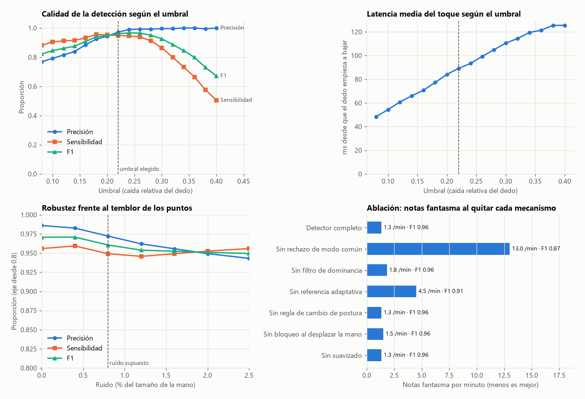

# Informe técnico — Piano Aéreo

**Autor:** Daniel Enrique Villamizar Ramírez
**Asignatura:** Ciencia de Datos

## 1. Resumen

Piano Aéreo convierte la cámara de un portátil en un piano. MediaPipe localiza
21 puntos de cada mano en cada fotograma; a partir de esa serie de tiempo, un
detector decide cuándo un dedo "pulsa" una tecla, y la nota se sintetiza en
tiempo real. Sobre ese núcleo hay cuatro modos de uso para interpretar
*Jingle Bells*, entre ellos un juego de ritmo al estilo de *Guitar Hero*.

El aporte principal desde la ciencia de datos es el **detector de toques** y su
**evaluación cuantitativa**:

- Se construyó un generador de sesiones sintéticas **etiquetadas** para medir
  precisión, sensibilidad, F1 y latencia.
- La evaluación descubrió un modo de fallo frecuente: notas fantasma al cerrar
  la mano. Se corrigió con un **rechazo de modo común**, que bajó las notas
  fantasma de 13,0 a 1,3 por minuto.
- El umbral y el suavizado se eligieron con datos, en lugar de a ojo.

Resultado en las condiciones de referencia: **F1 = 0,961, precisión 0,972,
sensibilidad 0,949, latencia media 89 ms**.

## 2. Planteamiento del problema

Cada mano produce, a unos 30 fotogramas por segundo, una matriz de 21 × 2
coordenadas en píxeles. El problema es una **detección de eventos en series de
tiempo multivariantes**: en cada instante y para cada dedo, decidir si empieza
un toque, termina o no pasa nada. Hay que hacerlo:

- **en línea:** con los datos hasta el fotograma actual, sin mirar el futuro;
- **con poca latencia:** la nota debe sonar mientras el dedo baja;
- **sin calibración:** cualquier persona, mano, distancia o cámara;
- **sin falsos positivos molestos:** una nota fantasma en plena presentación es
  peor que tener que repetir un toque.

Además del dedo, hay que decidir **qué tecla** toca. Cada tecla define un carril
vertical en la pantalla, y la tecla es la del carril donde está la punta del dedo.

## 3. Variables

| Variable | Definición | Por qué |
|---|---|---|
| Tamaño de palma *P* | Media de los tres lados del triángulo muñeca, nudillo del índice y nudillo del meñique | Escala de referencia propia de cada mano |
| Extensión de un dedo *e* | Distancia punta–nudillo dividida por *P* | Invariante a la distancia a la cámara: la prueba `test_extension_no_depende_de_la_distancia` lo verifica |
| Extensión del pulgar | Distancia de la punta del pulgar a la base del meñique, dividida por *P* | El pulgar no se dobla hacia la palma: se cierra sobre ella |

Un toque, visto desde la cámara, es un dedo que **se acorta** de golpe, ya sea
doblándose o inclinándose hacia la cámara. Inclinar toda la muñeca acorta a la
vez los dedos y la palma, así que el cociente apenas cambia. La normalización
absorbe ese caso sin ninguna regla extra.

## 4. El detector

Para cada dedo, en cada fotograma:

1. **Suavizado exponencial** de la extensión, con peso 0,8 para la medida nueva:
   reduce el temblor de los puntos.
2. **Referencia de reposo adaptativa y asimétrica.** Sigue a la extensión con
   rapidez cuando el dedo se estira (peso 0,5 por fotograma) y con lentitud
   cuando se acorta (constante de tiempo de 2,5 s). Un toque, que es brusco,
   destaca sobre ella; un cambio lento de postura se absorbe. Esto elimina la
   calibración manual.
3. **Caída relativa:** `caída = 1 − extensión / referencia`.
4. **Rechazo de modo común.** A la caída de cada dedo se le resta la mediana de
   la caída de los otros dedos largos. Si la mano entera se cierra, todos bajan
   a la vez y la caída propia queda cerca de cero. Si baja un solo dedo, la
   mediana de los demás es casi nula y la caída se conserva.
5. **Histéresis:** la nota se activa cuando la caída propia supera el umbral
   (0,22) y se suelta cuando la caída baja de la mitad del umbral.
6. **Filtro de dominancia:** un dedo solo dispara si su caída es al menos el
   60 % de la del dedo que más ha bajado. Así se ignora el dedo vecino que se
   arrastra por los tendones.
7. **Reglas de seguridad:**
   - antirrebote de 70 ms;
   - 0,3 s de "calentamiento" cuando aparece una mano, antes de poder tocar;
   - bloqueo mientras la mano se desplaza a más de 3 palmas por segundo;
   - liberación forzada tras 5 s pulsado;
   - si 4 o más dedos cruzan el umbral a la vez, se toma como nueva postura de reposo.
8. **Tecla:** se usa la posición de la punta *antes* de doblarse, con un filtro
   que solo se actualiza mientras el dedo está quieto. Al doblar el dedo
   (sobre todo el pulgar) la punta se desplaza de lado.
9. **Fuerza:** la velocidad de la caída en el fotograma del toque se convierte
   en el volumen de la nota.

## 5. Metodología de evaluación

No existe un conjunto de datos público de "toques de piano en el aire"
etiquetados. Por eso se construyó un **generador de sesiones sintéticas**
(`scripts/evaluar_detector.py`) con una mano paramétrica de 21 puntos
(`piano_aereo/simulacion.py`).

Cada sesión dura 60 s a 30 fps y combina:

- **Toques reales**, cada 0,55–1,3 s. Duración de bajada 70–150 ms, flexión del
  55–100 %, y dedos con distinta frecuencia de uso (índice y medio los más usados).
- **Arrastre del dedo vecino** en cada toque, del 10–40 % de la flexión del toque.
- **Desplazamientos de la mano entre teclas** (0,25–0,45 s), sin tocar mientras tanto.
- **Cambios lentos de postura** de un dedo (25–45 % en 2–3 s).
- **Inclinaciones de la muñeca** y **cierres de la mano** (los cuatro dedos
  juntos, 45–75 %).
- **Variación de la distancia a la cámara**: el tamaño de la mano oscila entre 95 y 145 px.
- **Ruido gaussiano** en los 21 puntos, del 0,8 % del tamaño de la mano como
  referencia; se barre del 0 % al 2,5 %.

Se conoce el instante exacto en que empieza cada toque real: esa es la etiqueta.
Una detección es un **acierto** si suena el dedo correcto en los 350 ms
siguientes; cualquier otra nota es un **falso positivo**. Las métricas son
precisión, sensibilidad (*recall*), F1, latencia media y falsos por minuto. Se
usaron 6 sesiones (295 toques) con semilla fija, de modo que los resultados son
reproducibles.

## 6. Resultados

Las tablas completas están en [RESULTADOS_EVALUACION.md](RESULTADOS_EVALUACION.md).

### 6.1 Hallazgo: el cierre de la mano

En la primera evaluación, el detector original (sin el paso 4) producía unas
13 notas fantasma por minuto. La causa no estaba prevista en el diseño. Al
relajar o cerrar la mano, los cuatro dedos bajan casi a la vez, pero **por el
ruido cruzan el umbral en fotogramas distintos**. La regla de "4 dedos a la vez"
nunca se activaba y el filtro de dominancia no ayudaba, porque todos tenían
caídas parecidas. El rechazo de modo común resolvió el problema:

| Variante | Precisión | F1 | Falsos/min |
|---|---:|---:|---:|
| Sin rechazo de modo común | 0,785 | 0,866 | 13,0 |
| **Con rechazo de modo común** | **0,972** | **0,961** | **1,3** |

Su coste es que una mano no puede tocar acordes de tres dedos o más (la mediana
de los demás deja de ser pequeña). Los acordes de dos dedos siguen funcionando,
y *Jingle Bells* no necesita acordes.

### 6.2 Elección del umbral

El umbral equilibra notas fantasma (umbral bajo) frente a notas perdidas y
latencia (umbral alto):

| Umbral | Precisión | Sensibilidad | F1 | Latencia | Falsos/min |
|---|---:|---:|---:|---:|---:|
| 0,18 | 0,925 | 0,956 | 0,940 | 77 ms | 3,8 |
| 0,20 | 0,943 | 0,953 | 0,948 | 84 ms | 2,8 |
| **0,22** | **0,972** | **0,949** | **0,961** | **89 ms** | **1,3** |
| 0,24 | 0,989 | 0,946 | 0,967 | 93 ms | 0,5 |
| 0,26 | 0,993 | 0,939 | 0,965 | 99 ms | 0,3 |

El máximo de F1 está en 0,24, pero la diferencia con 0,22 es pequeña (0,006).
Se eligió 0,22 por robustez ante un supuesto del simulador: la fuerza de los
toques. Al repetir la evaluación con toques más suaves (flexión del 35–70 %),
0,24 deja sin sonar un tercio de las notas y 0,22 conserva más:

| Umbral (toques suaves) | Sensibilidad | F1 |
|---|---:|---:|
| 0,18 | 0,895 | 0,912 |
| 0,22 | 0,732 | 0,834 |
| 0,24 | 0,671 | 0,802 |

Esto también justifica que la sensibilidad se pueda ajustar en vivo con `+` y
`-`: quien toca suave mejora mucho bajando el umbral a 0,18.

### 6.3 Elección del suavizado

Quitar el suavizado ahorra unos 7 ms de latencia en condiciones normales, pero
con ruido alto (2,5 %) las notas fantasma suben de 2,8 a 4,0 por minuto. El
valor 0,8 es el compromiso: 10 ms menos que el 0,6 inicial y buena resistencia
al ruido (ver la tabla "Elección de umbral y suavizado" en los resultados).

### 6.4 Robustez frente al ruido

Con el umbral elegido, el F1 pasa de 0,971 sin ruido a 0,949 con un ruido tres
veces mayor que el supuesto. El detector se degrada con suavidad en lugar de
romperse.

### 6.5 Ablación

| Mecanismo retirado | F1 | Falsos/min | Lectura |
|---|---:|---:|---|
| Ninguno (completo) | 0,961 | 1,3 | — |
| Rechazo de modo común | 0,866 | 13,0 | El más importante |
| Referencia adaptativa | 0,914 | 4,5 | Sin ella, los cambios de postura disparan notas y la sensibilidad cae |
| Filtro de dominancia | 0,956 | 1,8 | Aporta poco una vez que existe el modo común |
| Bloqueo al desplazar la mano | 0,959 | 1,5 | Efecto pequeño en la simulación |
| Regla de cambio de postura | 0,961 | 1,3 | Sin efecto: el modo común ya cubre ese caso |
| Suavizado | 0,962 | 1,3 | Sin efecto con ruido normal; protege con ruido alto (6.3) |

Los mecanismos sin efecto medible se mantienen **a propósito** como seguros
ante fenómenos que el simulador no modela, como el desenfoque por movimiento al
desplazar la mano rápido. Este matiz es honesto: la ablación mide lo que el
simulador representa, no todo lo que puede pasar con una cámara real.

## 7. Modo Ritmo: sincronización

El juego califica cada nota por su error temporal: *Perfecto* hasta ±0,12 s y
*Bien* hasta ±0,24 s en dificultad normal. Para que el juicio sea justo se
compensan dos retrasos:

- **Audio.** La latencia de salida se mide al abrir el dispositivo (22 ms en el
  portátil de pruebas) y la pantalla se retrasa esa cantidad, para que la nota
  cruce la línea justo cuando se oye el pulso.
- **Cámara.** Entre que el dedo se mueve y llega el fotograma pasan unos 50 ms.
  Es un supuesto, no una medida; al instante del toque se le restan esos 50 ms.

El acompañamiento (cuenta atrás, bajo, acordes y cascabeles; en Demo también la
melodía) se renderiza de una vez como una única onda. Así todo suena
sincronizado con precisión de muestra, en lugar de depender de la frecuencia
del bucle de dibujo.

## 8. Verificación del software

- **45 pruebas automáticas** (`python -m pytest`), sin cámara ni altavoces:
  - detector, partitura, síntesis, mezclador y modos de juego;
  - de extremo a extremo, tocar el coro completo sin errores en los modos Guía y Ritmo;
  - una **prueba de regresión de calidad**: una sesión sintética debe mantener
    F1 ≥ 0,94;
  - **pruebas de robustez:** cámara que no abre o se desconecta y se reconecta
    sola, audio que se pierde y se reabre, errores al dibujar que no cierran la
    aplicación, y grabación de vídeo y audio.
- **Prueba en hardware real** (Windows 11, Python 3.13, cámara integrada):
  - cámara lista en 2,4 s;
  - bucle a 32 fotogramas por segundo, con 8 ms de dibujo por fotograma;
  - ningún error en los cuatro modos;
  - vídeo y audio grabados con 23 ms de diferencia de duración.
- **Autodiagnóstico** (`python -m piano_aereo --diagnostico`): comprueba modelo,
  cámara (incluida la imagen negra por tapa cerrada) y audio antes de una
  presentación.

## 9. Limitaciones y trabajo futuro

- **Los datos de evaluación son sintéticos.** Sirven para comparar variantes y
  elegir parámetros con criterio, pero las cifras absolutas no garantizan el
  mismo rendimiento con manos reales. El siguiente paso es grabar sesiones
  reales (puntos de MediaPipe y etiquetas de cuándo se quiso tocar) y repetir la
  evaluación con ellas.
- **El retraso de la cámara (50 ms) es un supuesto.** Se puede medir grabando
  un toque con una cámara de alta velocidad, o con un clic sonoro sincronizado.
- **Acordes:** como máximo dos dedos a la vez por mano, por el rechazo de modo común.
- **Iluminación:** la detección de MediaPipe empeora a contraluz o con poca luz.
- **Teclado:** solo teclas blancas (Do mayor), suficiente para *Jingle Bells*.
